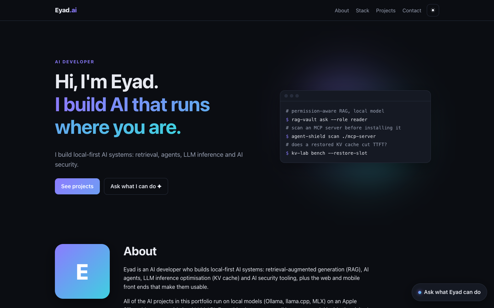
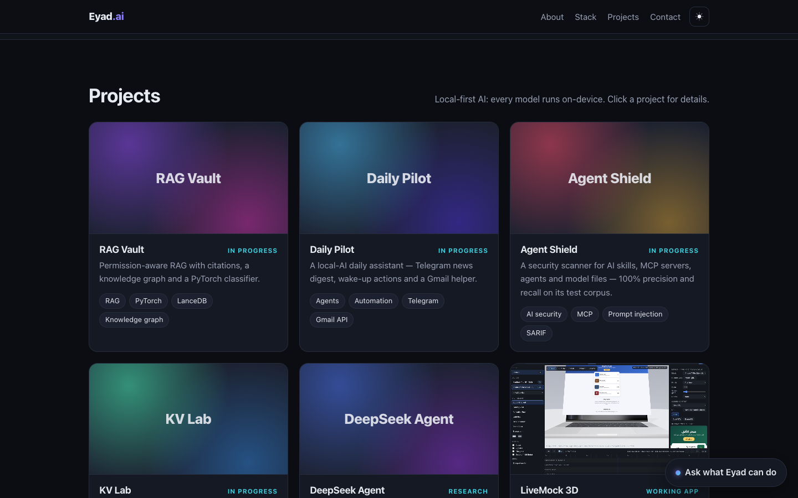
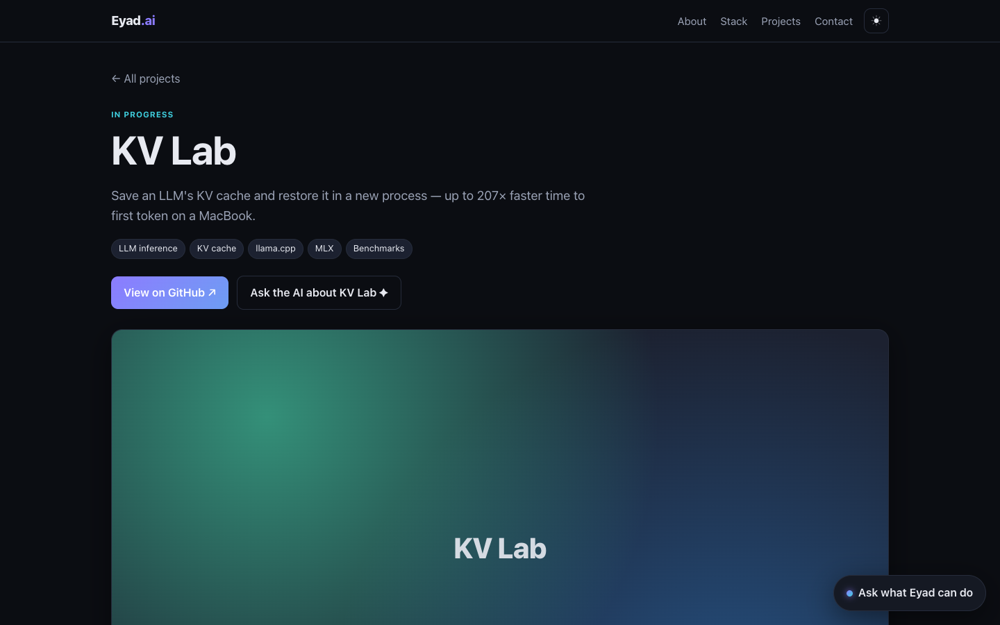
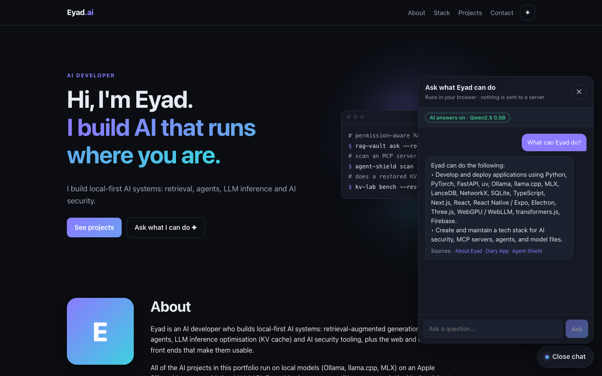
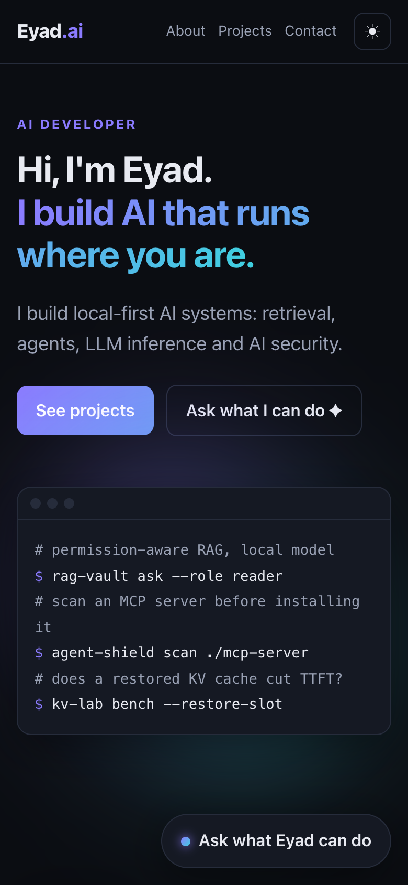

# Eyad — AI Developer (portfolio)

A fast, static Next.js portfolio with an **"Ask what Eyad can do" AI chat that runs entirely in the visitor's browser**: no server, no API keys, and nothing is sent anywhere.

## What it does (in simple words)

This is Eyad's personal website. It shows who Eyad is, the tools Eyad works with, and seven projects, each with its own page, results and a link to the code. It also has a small chat window where visitors can ask questions like "What can Eyad do?" and get an answer. The AI behind the chat runs inside the visitor's own browser, so no question ever leaves their computer.

How the chat answers a question, in 3 steps:

1. **Before the site goes live**, a build script cuts the site's text into small pieces and turns each piece into a list of numbers (an "embedding") that captures its meaning.
2. **When a visitor asks something**, the browser turns the question into numbers the same way and picks the pieces of text that match it best (by meaning and by keywords).
3. **A small AI model running in the browser** (Qwen2.5 via WebGPU) writes a short answer using only those pieces and links to its sources. If the device can't run the model, the chat shows the matching passages instead, and if the site doesn't contain the answer, it says so rather than guessing.

## Features

- **In-browser AI chat:** retrieval over the portfolio content (embeddings precomputed at build time) plus Qwen2.5 0.5B/1.5B running on WebGPU through WebLLM. The model loads lazily with a progress bar and falls back to search answers on devices without WebGPU. Sections that haven't been filled in get "not on this site yet" answers instead of guesses.
- **Pages:** hero, about, tech stack, project cards with a detail page per project, contact.
- **Theme:** dark and light, following the OS and remembering the visitor's choice. Responsive, no web fonts, static export.
- **Media:** room for LiveMock 3D videos on every project card and page.
- **Content:** everything personal lives in [`content/`](content/). Edit Markdown/JSON and rebuild.

## Tech stack

Next.js 16 (static export) · React 19 · TypeScript · plain CSS (design tokens) · [WebLLM](https://github.com/mlc-ai/web-llm) (Qwen2.5-Instruct, WebGPU) · [transformers.js](https://github.com/huggingface/transformers.js) (all-MiniLM-L6-v2 embeddings, WASM) · gray-matter + marked · GitHub Actions → GitHub Pages

## Screenshots

**Home / hero:** the first thing a visitor sees, with a short intro and buttons to the projects and the chat.



**Projects grid:** one card per project with its status, a one-line summary and tags. Click a card to open its page.



**Project detail page:** KV Lab's page with its headline result, tags, a GitHub link and an "Ask the AI" button.



**AI chat:** the in-browser chat answering "What can Eyad do?", with links to the sources it used.



**Mobile view:** the same site on a phone-sized screen.



## Quick start

```bash
npm install
npm run fetch-llm-libs   # once: self-host WebLLM's small model-library .wasm files (optional, recommended)
npm run dev              # http://localhost:3000 (rebuilds the chat index first)
```

Production build (static files in `out/`):

```bash
npm run build
npm start                # serves out/ on http://localhost:3000
```

Requires Node 20+. The first build downloads the 23 MB embedding model (`Xenova/all-MiniLM-L6-v2`) into the local Hugging Face cache; later builds are offline. No network? `npm run build:keyword-only` builds a keyword-search-only chat index.

## How the chat works

```
build time (Node)                         visitor's browser
──────────────────                        ─────────────────────────────────────────────
content/knowledge.md  ─┐                  public/rag/index.json  (chunks + vectors)
content/projects/*.md ─┴─► chunk ─► embed ─►        │
   (scripts/build-index.mjs,                         ▼
    all-MiniLM-L6-v2, 384-d)              question ─► embed (transformers.js, WASM) ─┐
                                                      BM25 keyword score ────────────┴─► top chunks
                                                                                         │
                                          WebGPU? ──yes──► Qwen2.5 0.5B/1.5B (WebLLM) ─► grounded answer + sources
                                                  └─no───► best-matching passages + sources (search mode)
```

- **Retrieval:** hybrid — 70% cosine similarity on precomputed embeddings + 30% BM25. Works on every device. Lines containing `TODO` are never indexed, so placeholders can't leak into answers.
- **Generation:** [WebLLM](https://github.com/mlc-ai/web-llm) runs Qwen2.5-0.5B-Instruct (≈0.4 GB, default) or 1.5B (≈1 GB) on WebGPU. It is loaded **only when the visitor clicks "Enable AI answers"**, with a progress bar, and cached by the browser afterwards. It picks the `q4f16` build when the GPU supports `shader-f16`, otherwise `q4f32`.
- **Fallback:** without WebGPU (older Safari/Firefox, some phones) the chat stays in search mode and answers with the most relevant passages plus links.
- The system prompt forbids inventing facts; the model only sees retrieved portfolio text.
- Downloads: page JS is small; the chat's libraries are code-split and fetched only when the chat opens. Model weights come from Hugging Face; the WebLLM model-library `.wasm` is served from `public/webllm/` when you ran `npm run fetch-llm-libs` (otherwise from GitHub).

## Updating content

| What | Where |
|---|---|
| Name, headline, photo, CV, links | `content/profile.json` |
| About / bio / experience / education (also the chat's knowledge) | `content/knowledge.md` |
| Tech stack groups | `content/stack.json` |
| Projects (one file each; front matter = card, body = detail page + chat knowledge) | `content/projects/<slug>.md` |
| Images / videos | `public/media/` |

Placeholders start with `TODO`. In `npm run dev` they show as yellow dashed boxes so you can see what's missing; **in the production build they are hidden** (and never indexed by the chat).

**Regenerate the chat embeddings** after editing anything in `content/`:

```bash
npm run embed     # also runs automatically before `npm run dev` and `npm run build`
```

### Adding a project

Create `content/projects/my-project.md`:

```markdown
---
slug: my-project
title: My Project
tagline: One line that sells it.
order: 8
status: In progress
tags: [PyTorch, RAG]
github: https://github.com/<you>/my-project
image: /media/my-project.jpg        # card + page image (optional; a gradient cover is used otherwise)
video: /media/my-project.mp4        # e.g. a LiveMock 3D export; autoplays muted on the card (optional)
gallery: [/media/a.jpg, /media/b.jpg]  # extra screenshots on the detail page (optional)
---

## Overview
...
```

### LiveMock 3D videos

Export a short clip (H.264 MP4, ~1280×720, < 5 MB, no audio), put it in `public/media/`, and set `video:` in the project's front matter. The `image:` is used as the poster frame. The LiveMock card currently uses app screenshots as placeholders.

## Deploy

### Vercel
Import the repo in Vercel — framework preset **Next.js**, defaults are fine (`npm run build`, output `out/` is detected via `output: "export"`). The build downloads the embedding model the first time (needs network).

### GitHub Pages
1. Settings → Pages → Source: **GitHub Actions**.
2. Add `.github/workflows/pages.yml` (already in this repo). It builds with `NEXT_PUBLIC_BASE_PATH=/<repo-name>` so links work under `https://<user>.github.io/<repo-name>/`. For a `<user>.github.io` repo, delete that env line.
3. Push to `main`.

Any static host works: upload `out/`. WebGPU needs HTTPS (or localhost).

## Project layout

```
app/                 pages (home, /projects/[slug]) + global CSS
components/          Chat, ProjectCard, Media, ThemeToggle, AskButton
lib/content.ts       reads content/ at build time (server only)
lib/rag.ts           in-browser retrieval (BM25 + embeddings) and WebLLM generation
scripts/build-index.mjs        content → public/rag/index.json
scripts/fetch-webllm-libs.mjs  WebLLM model libraries → public/webllm/
content/             everything personal — edit this
public/media/        images and videos
```
